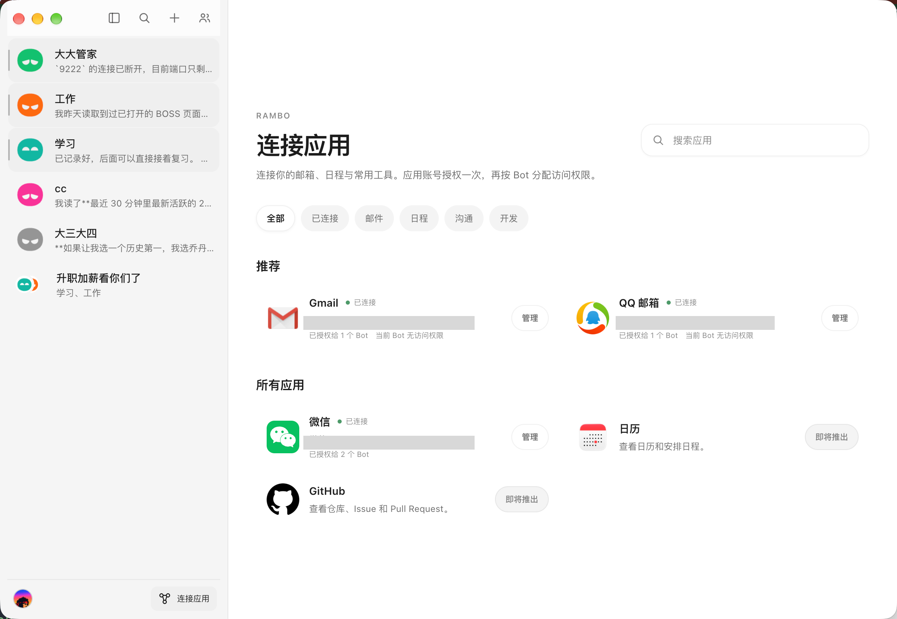
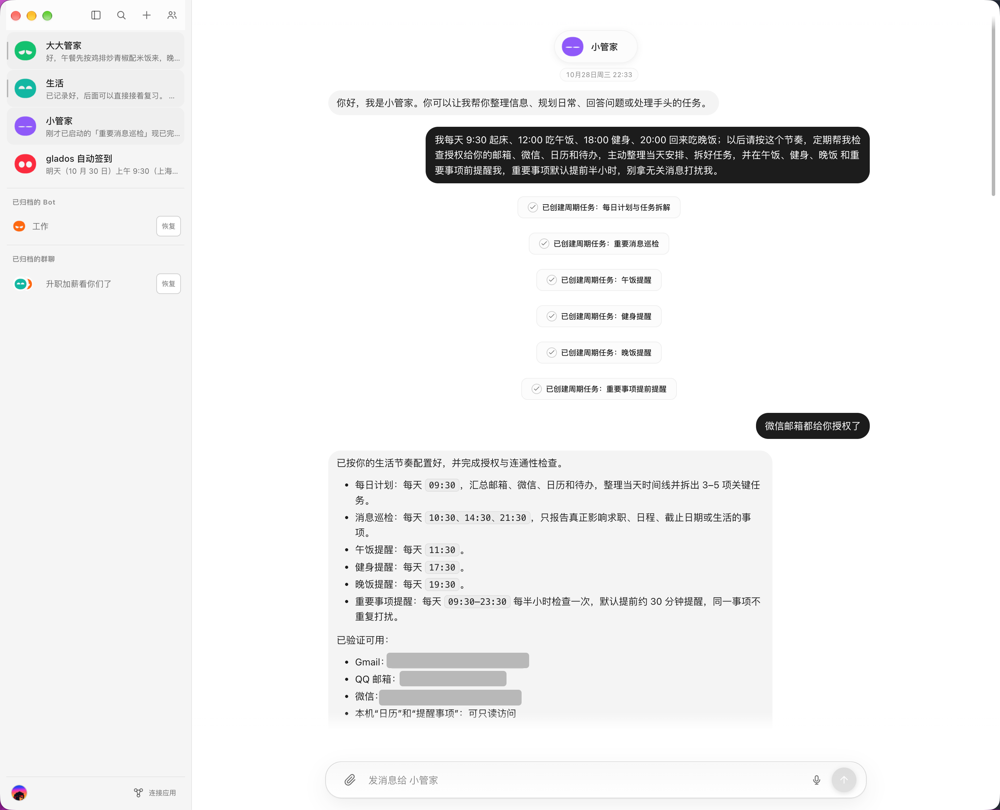

<p align="center">
  <a href="https://github.com/jiawei666/Rambo/releases/latest">
    
  </a>
</p>

<h1 align="center">Rambo</h1>

<p align="center">
  一台真正待在自己 Mac 上的个人 AI Agent。
</p>

<p align="center">
  <a href="README.md">English</a> ·
  <a href="https://github.com/jiawei666/Rambo/releases/latest">下载</a> ·
  <a href="docs/product-decisions.md">产品决策</a> ·
  <a href="docs/technical-design.md">技术设计</a>
</p>

<p align="center">
  <a href="https://github.com/jiawei666/Rambo/releases/latest"></a>
  
  
  
  
</p>

---

## 为什么做 Rambo？

我想把自己的 Codex App Server 接成一个真正长期待在本机的 Personal Agent，让它有自己的记忆，也能按我的生活和工作节奏做事。**Rambo** 就是为此而做的个人项目。

Rambo 的界面与交互基于对 **Grok Bot** 桌面端的反编译和界面研究构建，底层 Agent 运行时使用 **Codex App Server**。它把一套熟悉的 Mac 应用体验、可长期保存的 Bot 记忆和本机工具能力放在同一个产品里。

> **项目状态：** Rambo 正在快速迭代。最新版本可以用于日常探索和试用，但还不是一个已经完成全量验收的成熟产品。详情见[项目状态](#项目状态)。

## 应用截图

### 连接应用

<p align="center">
  <a href="assets/screenshots/connected-apps.png">
    
  </a>
</p>

<p align="center"><sub>邮箱和本机服务只需连接一次，再按 Bot 独立分配访问权限。</sub></p>

### 每日计划与独立任务

<p align="center">
  <a href="assets/screenshots/life-manager-routines-light.png">
    
  </a>
</p>

<p align="center"><sub>一句自然语言请求，就能生成当天安排、应用消息巡检，以及午饭、健身、晚饭和重要事项等多个独立任务。</sub></p>

<p align="center"><sub>截图中的账号标识已遮挡。</sub></p>

## 功能亮点

- **本机运行。** Bot、聊天、Routine、设置和记忆保存在自己的 Mac 上，使用独立的应用数据目录。
- **复用自己的 Codex 账号。** Rambo 启动并管理自己的 Codex App Server 子进程，复用本机 Codex 登录态，不需要再注册一个 Rambo 账号。
- **连接常用应用。** 支持 QQ 邮箱、Gmail，以及在本机微信环境和授权条件满足时连接微信。
- **自主规划任务和提醒。** 可以用自然语言创建一次性或周期 Routine，查看执行历史，并处理暂停、恢复、立即运行和补跑。
- **多 Bot 群聊。** 多个 Bot 可以进入同一个群聊协作，同时保留各自的私聊、记忆、模型和权限配置。
- **逐 Bot 控制资源。** 在共享资源目录中管理 Skills、MCP、Apps 和 Plugins，每个 Bot 独立选择自己可以使用的能力。
- **语音对话。** 可以从当前 Bot 发起 Live 语音会话，转写进入聊天；结束后继续用文字对话。
- **处理本机文件。** 支持图片、PDF、文本、Markdown、CSV 和常见音视频预览；拖入文件只插入本机路径；Bot 回复可以引用工作区内外的本机文件。
- **丰富的聊天内容。** Markdown、代码高亮、数学公式、Mermaid 图、问题卡片、结构化结果卡、媒体和 MCP 嵌入共用同一套聊天界面。

## 功能介绍

### 本机 Personal Agent

Rambo 不是一个必须开在浏览器标签页里的云端工作台。它是一台 macOS 原生应用，自己管理 Agent 运行时，把产品数据保存在本机。它面向的是一个长期自用的个人助手，而不是又一个需要注册账号的 SaaS 产品。

### 基于 Grok Bot 界面研究的复刻与扩展

已有页面、组件、样式和交互以对 Grok Bot 桌面端的反编译证据为依据，按已确定的产品范围复刻；Grok Bot 没有而 Rambo 需要的功能，则沿用同一套组件风格扩展。

Rambo 是独立项目，与 Grok、Google、OpenAI 以及所连接的服务没有隶属关系。

### 连接邮箱、微信和其他应用

当前规划/实现中的连接包括：

- **QQ 邮箱**：搜索、读取、附件、草稿、回复和发送。
- **Gmail**：支持应用专用密码和 OAuth，并处理 Gmail 的本地化系统文件夹。
- **微信**：在完成本机微信环境、授权和本地数据库读取条件后，查询聊天和消息。
- **日历、GitHub 等 MCP 服务**：通过 MCP 和资源目录接入。

连接按 Bot 分配。一个 Bot 获得授权，不会自动把所有连接暴露给其他 Bot。

### 自主规划 Routine 和提醒

可以让 Bot 记住一件事、在之后执行任务，或按周期检查状态。Rambo 的 Routine 支持：

- 一次性任务和周期任务
- 一天内多个离散触发时刻
- 用自然语言创建、修改和暂停
- 立即运行、停止和查看执行历史
- 结果回到创建任务的 Bot
- 应用未运行时的补跑规则和去重

任务计划、触发记录和实际执行状态分开保存。创建了计划不等于未来已经成功执行。

### 多 Bot 群聊

群聊中的每个 Bot 都有自己的私聊上下文、模型、权限和资源开关。成员在同一个共享时间线中协作，实际执行内容仍然可以追溯到具体 Bot，而不是伪装成一个全局 Bot 的转述。

### Skills、MCP、Apps 和 Plugins 独立控制

Rambo 使用三层资源模型：

1. 发现本机可用的 Skills、MCP、Apps 和 Plugins。
2. 把需要的项目加入全局可选目录。
3. 每个 Bot 独立决定是否启用。

新建 Bot 时复制一次当时的共享默认值；创建之后，修改其他 Bot 或全局默认值不会悄悄改写这个 Bot 的配置。

### 语音对话

从当前 Bot 发起语音会话，实时转写会进入聊天。结束语音后，同一个 Bot 可以继续用文字处理后续任务。语音状态、转写和正式回复都围绕同一条 Bot 会话，而不是另开一个孤立页面。

### 聊天工作区与文件

聊天界面由悬浮的 Bot 标题、可滚动的消息区和底部输入框组成。文件可以在应用内预览、交给本机应用打开、在 Finder 中定位，也可以由 Bot 回复直接引用。

拖入输入框的文件只会插入本机绝对路径，不会自动上传或复制文件，也不会创建附件记录；附件处理仍走独立的附件流程。

## 架构

```text
┌─────────────────────────────────────────────┐
│ Rambo.app                                   │
│  Electron + React + TypeScript              │
│                                             │
│  Bot · 聊天 · 群聊 · Routine · 记忆         │
│  连接应用 · 资源开关 · 文件                 │
└──────────────────────┬──────────────────────┘
                       │ stdio
┌──────────────────────▼──────────────────────┐
│ Codex App Server                            │
│  由 Rambo 启动和管理的独立子进程            │
└──────────────────────┬──────────────────────┘
                       │
             本机 Codex 认证与工具资源
```

Codex App Server 不随 `.app` 打包。Rambo 优先使用本机已有的 Codex 运行时，必要时使用校验后的缓存或独立 package，并把产品数据放在本机应用数据目录。认证复用本机 Codex 配置，Rambo 不建立第二套账号体系。

## 安装

从 [GitHub Releases](https://github.com/jiawei666/Rambo/releases/latest) 下载最新的 macOS arm64 版本。

1. 解压下载的 zip。
2. 把 `Rambo.app` 拖入“应用程序”文件夹。
3. 当前版本没有 Developer ID 签名，也没有公证，因此首次启动会被 macOS Gatekeeper 拦截。打开“系统设置 → 隐私与安全性”允许打开，或在 Finder 中按住 Control 点击应用并选择“打开”。
4. 确保本机已有可用的 Codex 安装和认证。Rambo 会优先使用本机运行时。

应用只有本地 ad-hoc 签名，不是无警告安装，也不包含 Developer ID 证书。

### 从源码开发

环境要求：

- Apple Silicon 上的 macOS
- Node.js 和 npm
- 本机 Codex 运行时

```sh
npm install
npm run dev
```

常用命令：

```sh
npm run build          # 构建 Electron 应用
npm run package:mac    # 生成未打包的 macOS 应用目录
npm run typecheck      # TypeScript 检查
npm run verify:fast    # 后端、验收、目录和台账检查
```

Rambo 使用独立的 Codex Home 保存应用自己的会话和状态，同时复用本机 Codex 认证和所需配置；不复制凭据，也不把 Rambo 的会话混入普通 Codex 历史列表。

## 项目状态

当前版本为 **v0.1.6**。验收目录包含 **148 条产品规则**、**237 个局部测试案例**、**118 个可执行案例**和 **119 个明确缺口**。

最新版本的确定性检查和定向 Electron 用例通过，但这不等于所有产品规则都已完成验收。真实设备语音、外部账号、系统原生行为和部分完整端到端流程仍待复验。仓库把规则级状态和证据分开保存，避免把局部测试误报成完整产品验收。

详情见[全量验收矩阵](docs/acceptance-matrix.md)、[验收测试计划](docs/acceptance-test-plan.md)和[实施记录](docs/implementation-progress.md)。

## 文档

- [产品决策](docs/product-decisions.md)
- [技术设计](docs/technical-design.md)
- [全量验收矩阵](docs/acceptance-matrix.md)
- [验收测试计划](docs/acceptance-test-plan.md)
- [实施记录](docs/implementation-progress.md)
- [文件预览兼容性](docs/file-preview-compatibility.md)
- [品牌素材](docs/branding.md)

## 许可

本项目采用 [MIT License](LICENSE) 开源。

## 致谢

Rambo 的界面研究基于 Grok Bot 桌面端；Agent 运行时基于 Codex 和 Codex App Server。感谢 Electron、React、Vite、Mermaid、KaTeX 和本机媒体工具等项目为这个应用提供基础能力。
