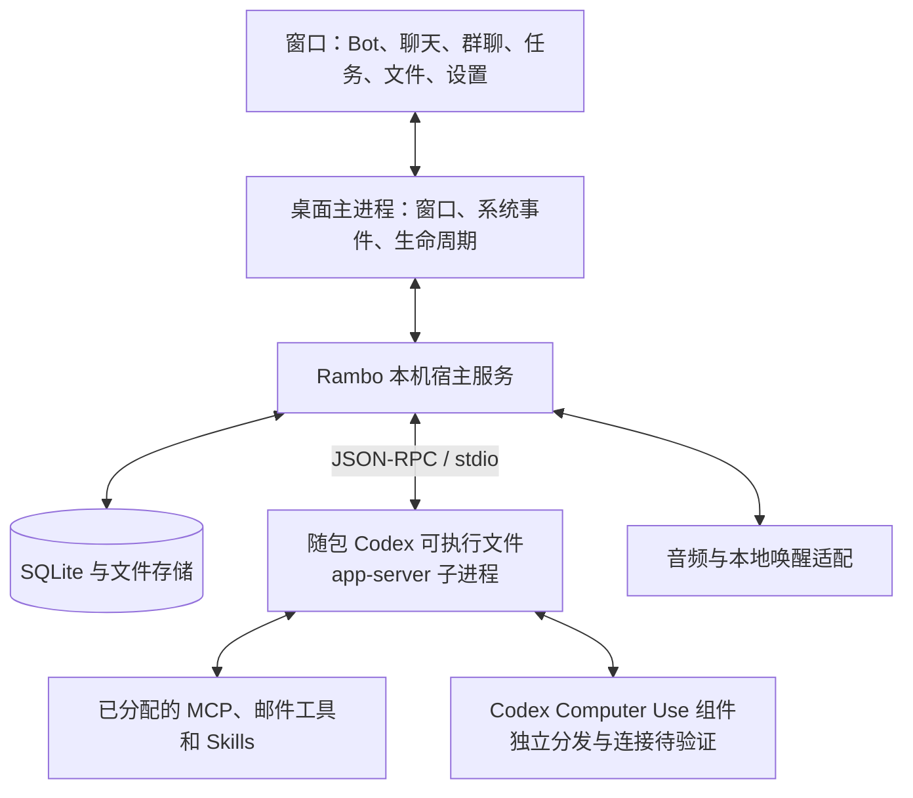

# Rambo 技术设计草案

日期：2026-10-20。状态：用户已授权实现，Electron / React / TypeScript、本机 SQLite、独立 App Server 方案开始落地；下文“本轮未执行”等为设计调查时的历史边界，最新实际执行见 [实施进度](implementation-progress.md)。未完成全量运行验证。

同日只读调查补充：Voice 优先显式 WebRTC；CLI 的 App Server 子命令存在历史来源问题，但后续已找到上游独立 App Server 的来源参数与发行物条目，当前优先采用该候选；Computer Use 有额外本机组件依赖。结论汇总见 [可行性状态](feasibility-status.md)；本文相关段落已按调查修正。

产品依据：[产品决策](product-decisions.md)、[全量验收矩阵](acceptance-matrix.md)。本文把已选产品行为映射到实现模块；技术建议不替代用户决定，也不将接口存在写成能力已经打通。编号规则及工作约定持续更新，仍须按原矩阵验收。

## 1. 总体方案

建议采用 Electron + React + TypeScript 构建桌面界面，后台由应用拥有的本机宿主服务统一管理，使用 SQLite 保存产品数据、普通文件保存附件和成果。macOS 音频、设备选择和电源管理通过窄接口的原生辅助模块接入；具体依赖版本在实现前固定。

这是技术推荐，不是用户已选的技术栈。理由是便于还原 Grok 的聊天界面、连接本机子进程并复用类型化协议；代价是桌面壳的体积和原生音频桥接工作。没有因为选此方案增加云端业务服务。

这里的“宿主服务”是 Rambo 自己的本机进程，不是互联网上的服务器。Codex 执行与实时语音仍可能需要网络；“数据以本机保存”不表示离线推理，P03 不应被解释为任务内容绝不发给所连接的服务。

### 职责边界

| 部分 | 承担职责 | 对应规则 |
| --- | --- | --- |
| 界面 | Grok 风格页面、消息展示、设置、用户确认、通知入口 | P02、B04/B07/B10/B11、F03/F05 |
| Rambo 宿主 | Bot 身份、会话映射、协作调度、计划触发、记忆持久化与归属、文件索引、语音连接与收尾 | B/M/G/R/C/V/O 各组 |
| Codex App Server | Agent 回合、上下文、模型工具调用、Codex 认证、Voice 协议 | A01–A06、B02/B06/B09、V01/V02 |
| 本机工具与连接器 | 真实桌面操作、邮箱协议/API、外部应用访问 | C01、T01–T13 |

自然语言请求、语音插话、工具选择和任务中的截图时机沿用 Codex。不另造一套邮件语音解析、关键词挂断或插话分类器，Q17/Q50 的撤回继续有效。

## 2. 打包、启动与退出

### 包中是什么

随应用放入固定版本的上游独立 App Server package 及其实际需要的配套资源；当前推荐使用独立 `codex-app-server` 的来源参数，不再将 CLI 的 `codex app-server` 子命令当成唯一入口。该独立发行物已完成归档清单核对，尚未执行其程序，见 [历史隔离方案](history-isolation-plan.md)。不是把 Codex 桌面 GUI 打进包，也不是把模型权重放进包。已核实本机 npm 的 `codex` 入口是 JS 启动器，不能只复制这个入口就宣称独立可运行；最终须定位完整原生发行物、依赖及许可文件。[本机核对](app-server-evidence.md)

建议包内预留 `Resources/runtime/codex/<version>/`，按最终独立 package 的 manifest 保留其全部相对布局；现有 CLI 平台包包含 `bin`、`codex-resources`、`codex-path`，由版本清单记录架构、校验和及协议快照。本机 0.163.0 arm64 原生目录约 325.0 MiB，其中 Voice 配套整目录约 20.18 MiB；这不是最终应用/压缩安装包大小，Computer Use 配套也不在此清单。来源见 [CLI 发行物清单](evidence/codex-0.163.0-darwin-arm64-inventory.json)。当前优先的独立 App Server package 已另行核对，压缩约 97.26 MiB、逻辑大小约 249.15 MiB，4 个文件，包含 Code Mode Host 和 rg，但没有 Voice Host 或 Computer Use 服务，见 [独立包清单](evidence/codex-app-server-0.163.0-darwin-arm64-inventory.json)。不得把两套包的大小或资源混为一谈。

### 生命周期

1. 启动桌面主进程，打开产品数据库并执行可回滚的迁移。
2. 启动 Rambo 宿主，推荐拉起包内独立 `codex-app-server --listen stdio:// --session-source app-server`；这是拟定启动形态，本轮未执行。
3. 完成 `initialize` / `initialized`，建立请求 ID、事件分发及断线状态。
4. 读取账号状态、可用模型及资源目录；已认证不重复登录，未认证按 A03 使用 Codex 登录流程。
5. 恢复队列和计划，再按已保存开关恢复唤醒；首次未启用的唤醒不自行开启。
6. 关闭窗口时保留主进程和后台宿主；`⌘Q` 则退出并收尾本应用拥有的服务。

只使用自己拉起的进程句柄及 PID 管理启停，不按进程名杀死其他 Codex 客户端。stderr 进入脱敏诊断日志，stdout 专用于协议。stdio 请求失败、初始化失败和后台崩溃都要显示真实状态，不能把“进程存在”显示为“Agent 可用”。

升级沿 A05/A06：新版本随应用发布，待当前轮次结束再切换；队列、计划和本地数据保留。版本迁移失败使用升级前备份，不能通过清空用户数据解决兼容问题。

## 3. 认证、配置及历史隔离

### 复用与覆盖

- 按 A03 使用本机同一 `CODEX_HOME` 的 Codex 认证与配置，不复制认证文件到项目或备份包。
- 只把 Rambo 自身的设置写入产品数据库。Bot 模型、当前线程权限和可用工具集合以线程参数/进程参数覆盖，不为了一个 Bot 改写全局配置。
- 用户在应用里明确新增的共享 MCP 或导入的共享 Skill 属于已批准的资源管理动作；其写入范围需在资源适配层集中处理。
- 共享认证意味着在 Rambo 里改变登录状态可能影响其他客户端；不承诺有独立账号或独立凭据生命周期。

### 三层身份

| 身份 | 用途 |
| --- | --- |
| `botId` | Rambo 的长期角色、资料、资源分配和记忆 |
| `chatId` / `runId` | 用户聊天或一次任务执行，控制展示和归属 |
| Codex `threadId` / `turnId` | 底层上下文和实际执行，保存映射而不让用户手工管理 |

每个 Bot 只有一个持续私聊和对应 thread；文字与 Live 沿用该 thread，不创建第二条私聊。Routine、独立异步任务和群聊成员会话仍各自有独立执行上下文。Rambo 的聊天列表只显示每 Bot 唯一私聊及显式群聊，不直接把 `thread/list` 的所有结果当成本产品聊天。

**历史隔离已发现现方案的静态反证。** 匹配 0.163.0 官方源码中，现成 `codex app-server` 的普通新线程使用 `SessionSource::VSCode`；原生 CLI 默认恢复列表包含此来源。`threadSource` 是另一层分析标签，不能替换这一来源，`clientInfo.name` 和 `serviceName` 也不能完成隔离；本地非空 `originators` 过滤不支持。调用链已核对到初始化、新线程构造和列表过滤，详见 [历史隔离调查](history-isolation-research.md)。

因此不能照原先“同目录、改标签”的方式实现并宣称 A04 成立。第二轮已找到更直接的上游入口：独立 `codex-app-server --session-source app-server` 将根线程置于 AppServer 来源。当前桌面产物的默认历史请求及其 0.153.4 后台过滤，也已静态核对为排除此来源的默认集合；全局 CLI 0.163.0 同样如此。优先方案及版本边界见 [历史隔离方案收敛](history-isolation-plan.md)。这仍需真实包内执行、跨版本共享存储、资源发现和恢复验证；不声称是文件保密隔离，也不改成复制认证文件。

## 4. 数据与一致性

建议单一宿主拥有 SQLite 写入连接，界面和工具适配器通过宿主操作，避免多个进程各自改任务状态。

| 数据实体 | 关键内容 |
| --- | --- |
| Bot | 名称、头像、职责、长期指令、默认模型、资源分配、归档状态 |
| Chat / ThreadBinding | 每 Bot 唯一私聊或群聊成员执行会话、Codex thread 映射；旧重复私聊仅作本机隐藏历史保留 |
| Message / Item | 原始条目标识、用户可见文本、来源、时间、运行与文件引用 |
| Group / Membership | 成员、成员状态；原 defaultBotId 为旧路由字段，后续迁移不得继续作为普通群消息兜底依据 |
| Task / Delegation | 根任务、父任务、接收 Bot、状态、依赖、停止请求和结果 |
| Routine / Run | 当前计划版本、触发时间、执行时指令快照、状态与结果 |
| Memory | Bot 自动整理保存的记忆、所属 Bot 或“关于我”、来源；旧候选/批准字段的迁移待实现 |
| Blob / FileReference | 内容哈希、单份本机副本、引用者、长期资料/临时附件/成果分类 |
| Notification / Settings | 未读、逐 Bot 开关、语音设备及唤醒开关、成功通知例外 |

产品消息/索引是面向界面的投影；Codex thread 的执行历史通过协议读取和恢复，不自行改写其内部数据库。使用稳定的 turn/item ID 合并流式更新，避免重连时重复追加同一条回复。没有 provider 事件 ID 的通知按具体类型设计合并规则，不能简单用文本去重。

SQLite 事务内同时落任务状态和待派发事件；随后由 outbox 派发并记录结果。跨数据库、进程和外部服务不存在自动事务，发送邮件等动作处于不确定状态时按 R07/O04 等待处理，不宣称可保证所有外部动作恰好一次。

搜索使用本机消息正文、任务摘要和文件名索引，按 B10 筛选定位；不额外引入文件全文、OCR 或语义检索功能。

## 5. Bot 上下文、记忆与文件

首次创建/恢复 Bot 唯一私聊 thread 时，由宿主按归属准备 Bot 职责、已保存的“关于我”和私有记忆、已启用资源及当前聊天附件引用。后续配置变化要有版本号，明确在哪个新回合生效；模型切换仍按 B06，不改写执行中轮次。升级数据库时保留最近的未归档私聊 thread，其他重复私聊保存在本机但不加入产品列表、搜索或运行映射。

### Bot 自管理 Tools

按 Q64/B13，宿主向 Bot 的唯一私聊暴露一组窄范围动态工具，操作对象固定为当前 thread 所属 Bot，参数不接受任意 `botId`：自身资料（名称、头像、短职责、长期指令）、默认模型、默认权限、当前私聊模型/权限覆盖、自身专属记忆、自身 Routine。会话绑定和所有权由宿主从 `threadId → chatId → botId` 解析，模型参数不能选择目标 Bot。

合法写入不另设逐次用户批准。默认模型和权限在当前轮使用旧快照，下一轮重新解析；名称、头像、职责变化在成功写入后发布 UI 变化，并同步更新侧栏、详情页和群聊消息身份。自身记忆删除要与闲聊原文分开，Routine 修改/暂停/恢复/删除复用 R13/R14 和执行快照规则。

工具集合不包含自我归档、永久删除 Bot 或清空聊天，也不提供可传入其他 Bot ID 的通用设置接口。宿主应对未注册工具名、越权对象和间接组合操作返回失败；该工具边界是产品能力限制，不冒充 Full Access 下的文件系统安全隔离。

当前实现差距：只注册了 `create_routine`、`save_memory` 和旧审批模式的 `save_bot_instruction`，缺少其余工具及统一所有权校验；动态工具在 `thread/start` 注册，现有 thread 只 `thread/resume` 不能新增工具，因此旧数据迁移、必要的新 thread 初始化或等价重新注册策略仍待验证。完成这些不改变规则，也不替代真实 Electron/App Server 验收。

### 记忆

按 Q56/M01–M07，由当前 Bot 在交流告一段落后自动整理并保存长期记忆，明确要求记住时当场处理；文字和 Live 共用持久化规则，无需候选批准。共享“关于我”和 Bot 私有记忆继续按归属分别管理，设置里保留查看、编辑和删除。整理是否额外启动 Codex 回合仍待设计，不能直接等同于另设隐藏记忆 Agent。

Codex 自带记忆与本产品记忆的衔接需核实，确保真实写入可被管理页及后续上下文读取，且符合 M03 的共享/私有归属；不能仅靠模型声称已记住。Full Access 下该归属规则不是文件系统沙箱。

不新增 M08 已排除的记忆撤销和差异历史界面。按 Q64，当前 Bot 可删除自己的私有记忆，共享“关于我”和其他 Bot 的记忆不属于该工具范围。实现差距：长期指令宿主提示仍要求旧审批，记忆数据仍有 approved 字段，且尚无删除记忆与完整自身 Tool 路由；自动整理、旧候选处理及 Live 接线均待实现/验收，本轮仅更新规则。

### 附件与成果

上传时算内容哈希、原子写入 blob 库，建立引用后才返回可用附件；同内容复用一份副本。当前聊天附件不会因同哈希被另一个 Bot 引用而自动成为跨 Bot 上下文。长期资料需显式升级引用范围。

默认成果写 Bot 工作区，明确指定外部路径则按指令使用原路径，不复制整项目。只回收无引用且符合清理规则的应用托管内容；永久删除 Bot 不扫外部目录。图片/PDF/文本/CSV/音视频预览和其他格式交系统应用按 F05 验收。

应用 Logo 使用 `assets/branding/app-logo-source.png`；派生系统图标只做尺寸与容器适配。Bot 头像仍独立，生图能力列入后面的阻塞项，不以占位图片冒充模型生图通过。

## 6. 群聊、协作与调度

### 群聊界面

按 Q57/G01，群聊与单聊共用列表及界面样式，通过多个成员机器人头像组合呈现群头像，不另设群聊分组样式。可复用列表行与聊天壳组件，消息仍绑定实际发言 Bot。当前 renderer 仍有独立的“群聊”分区和通用 users 图标，组合头像与统一列表待实现及验收。

### 消息路径

按 2026-10-21 Q55、2026-10-22 Q63/G02–G04，普通群消息由各活跃 Bot 根据自身职责和共享群上下文自行判断是否回复，可多人回复；`@名字` 直接指定目标，`@everyone` 分别派发给全部活跃成员。取消隐藏 Codex 回合集中选人及任何固定默认 Bot 兜底；全员不回复、判断失败或超时都不得自动交给固定默认、第一个加入或群主 Bot。具体提示、重试和手动指定方式待技术设计收敛，不默认创建每 Bot 的额外隐藏判断线程。

决定回复的 Bot 在自己的执行会话中发言，宿主把公开进度和结果投影回群；具体协作任务仍由该任务发起者汇总。新成员可见加入前的近期群上下文，更早群历史按需查找，仍不自动取得其他 Bot 私聊。

当前 `src/main/host.ts` 的 `sendGroup` 不再调用集中路由器或默认 Bot；旧 `defaultBotId` 字段只作为迁移数据保留，不参与 responder 选择。源码状态不等于当前构建的全部群聊行为已经验收通过。

应用提供内部委派工具，记录根/父任务和祖先链；最多 4 次连续转派并拒绝回派祖先。依赖由宿主记录阶段，不能仅靠提示词防止依赖未完成就执行。并行兄弟失败相互独立，负责人汇总结果；主动停止按整棵对应任务树传播。

### 调度资源

| 资源 | 调度设计 |
| --- | --- |
| 普通任务执行名额 | 默认全应用 3 个，可调；只管理 Rambo 任务 |
| 真实电脑 | 全局排他租约，同刻一个任务，FIFO，30 分钟后停放，空闲可恢复 |
| 已知同项目独立修改 | 以明确目标项目路径串行；只读和其他项目不占该写入名额 |
| 单个聊天 | 普通新消息沿 B09 转向当前任务，不默认放到任务末尾 |
| 协作等待 | 父任务等待子任务时不占用会导致子任务无法启动的全部执行名额 |

任务状态建议为排队、执行、等待电脑、等待用户、等待子任务、停放、完成、失败、中断和取消。UI 状态与 provider turn 状态分别记录；“等待”不等于结束，模型仍在产生输出也不能假称已经暂停。

内部恢复/控制回合不能被普通任务名额全部占满。具体等待是否可以保持工具调用未决，或需结束当前回合并在结果到达后续开一轮，依据 App Server 实际行为选择；这是调度技术设计，不重新追问用户。

### 电脑互斥的关键限制

依赖核对见 [Computer Use 本机组件调查](computer-use-dependencies.md)：统一 REPL 使用专用 trusted nodeRepl 与原生管道，旧 MCP 入口调用独立原生客户端，两者都不等同于 Codex 主程序内置桌面驱动。没有将插件配置路径改成 Rambo 即可独立分发的证明。

需要在真正的 Computer Use 调用前取得租约，而不是截图后才排队。若官方组件调用完全绕过宿主，就必须找到可拦截的连接/工具层，或在执行前以更粗粒度串行化所有可能使用电脑的任务。仅在 UI 写“正在排队”不能保证 C02。

进程崩溃后不能只因租约过期就把电脑交给下一任务：先证明原调用已终止或被隔离，防止旧调用仍在操作。手动接管是独立状态，不能把 `turn/interrupt` 描述成已实现无损暂停。

## 7. 定时任务与 Webhook

宿主调度器是本产品计划的唯一调度源；当前 Bot 的聊天工具、Live 委派工具与管理页操作同一份 Routine。每次触发形成 `routineId + scheduledAt` 唯一键并保存指令快照；手动执行用不同触发 ID，不覆盖历史。

文字聊天从明确的周期委托意图中抽取任务名、指令和计划并直接保存；关键条件含糊时先澄清，Bot 自己提出的自动化想法仍先征得用户同意。当前 Bot 可按 Q64 修改、暂停、恢复和删除自己的 Routine，但所有权固定来自当前会话，不能指定其他 Bot。左侧任务页列出所有 Bot 的 Routine，Bot 详情页按 `botId` 列出该 Bot 管理的任务，两处读取同一数据。

执行规则直接采用 R01–R16：12 小时以内最多一次补跑、单次错过手动处理、不重入、最多一次短暂错误重试、同因连续失败通知去重、成功默认不发系统通知。

- 暂停计划：停止未来触发、取消未开始的排队执行；已经开始的继续，除非明确停止。
- 修改计划：只影响后续新触发，已有执行用原快照。
- 删除计划：移除定义但保留 run、聊天简报和成果，并保证仍有可达历史入口。
- 一次性任务：终止自动触发后保留列表与真实状态，可手动立即运行。

Webhook 作为本机/LAN 的宿主适配器，不为 UI/App Server 额外开放远程控制端口。设计建议每个入口使用高熵凭据、限制请求体大小、持久化事件 ID 做重复请求去重；默认监听范围由最终部署配置明确。提供者没有稳定事件 ID 时，只能给出可解释的有限重复防护，不能用内容相同就永久拒绝合法请求。

这些 Webhook 参数是技术建议，尚未变成用户批准的具体接口契约；专属邮箱事件、托管队列、远程手机呼叫仍不纳入首版。

## 8. Codex Voice 与唤醒

### 两条链路

本地唤醒适配器仅处理唤醒入口，不承担完整语音助理：已启用监听 → 检测 Rambo → 恢复默认语音 Bot 的唯一私聊 thread → 开启 Codex Live。

通话链路负责设备、音频传输、状态及收尾；Codex Voice 负责交谈与语义。空闲自动结束、专用挂断动作、记忆自动保存等已经确认的宿主工具由通话适配层接通，不新增口头切换 Bot，也不重新实现用户插话策略。

本机新生成 0.163.0 schema 存在 `thread/realtime/start`、音频/文本追加、停止及关闭通知，属于实验接口。匹配构建源码进一步显示：**优先显式传 WebRTC SDP、V3、audio**，App Server 通过已有 ChatGPT 认证创建通话，Rambo 自己管理 WebRTC 媒体。省略 transport 的 core 路径默认 WebSocket，该分支当前仍有 API Key 限制；不作为免额外 Key 的方案。具体 V3 账号资格和真实调用仍待证明。[Voice 调查](voice-feasibility.md)

### 连接和资源状态

建议状态：关闭、等待唤醒、连接中、Live、结束中、设备不可用、连接失败。每次通话产生本地 `voiceSessionId`，与 bot/chat/thread 和设备选择绑定；旧回合的挂断请求只对其绑定的当前会话生效，不可关闭后来的通话。

结束时停止该通话音频上传和播放、关闭媒体连接并向 App Server 发停止，分别记录本地释放及服务端关闭状态。服务端确认超时也应先释放本机麦克风，不显示虚假的已确认服务端关闭；按已保存开关恢复唤醒。结束通话不杀 App Server，也不停止独立任务。

挂断优先采用已查到的 Live → 普通 Codex 委派 → 宿主动态工具通路；尚无普通线程 dynamicTools 会自动直接注入 Live 模型的证据。`thread/realtime/stop` 关闭 core 实时状态，不代替 Rambo 停止媒体音轨和 PeerConnection。若整条通路不可用，V07 仍被阻塞，不能退化成匹配“退下”字符串并宣布验收通过。

### 本地音频

默认跟随 macOS 输入输出，可固定设备；固定设备断开按 V14 提示不可用、不自动切换。原生辅助层是否能及时阻止系统自动改路由必须实测。唤醒和 Live 共享设备访问协调，不能各自重复采集而导致竞争或把播报声当作新唤醒。

本地唤醒引擎尚未选定：先比较能否支持用户指定称呼及问候说法、离线检测、合盖耳机输入、资源占用和分发许可，再固定实现。不能因 UI 中填了 Rambo 就视为检测器可用，也不默认要求用户另买服务 Key。

完整 Live 录音不长期落盘，保留转写和任务结果；唤醒音频使用瞬时内存处理，不作为日常录音档案。实时协议可能包含音频 base64，诊断日志不得整包记录媒体或令牌。实际唤醒音频存储策略及引擎行为还需核对，以 V13 的通话录音规则为最低要求。

## 9. MCP、Skills、邮件与图像

### 逐 Bot 可用资源

共享资源目录 + Bot 分配表。每次构造执行会话时形成有效工具集合，分配是工具曝光/上下文组织，不是 Full Access 下的访问沙箱。

本机协议存在 Skills 列表和全局配置写入、线程配置覆盖等接口，但不能直接推断全局开关就是逐 Bot 开关。禁止在共享进程里为 Bot A 开关全局 Skill 导致 Bot B 同时变更。先证明线程级选择与 MCP 可见性过滤；若只有进程级配置，再评估按资源配置分组的独立 App Server 子进程，并仍统一调度。后者属于备选架构，尚未验证。

MCP 连接凭据在本机安全存储中保管，产品数据库只存引用；授权与导入只在用户设置或明确请求下处理。新增本地 Skill 保留配套目录，默认不全局启用。主动提议保存技能和用户明确保存的区别沿 T09。

### 邮箱

QQ 与 Gmail 各一个账号，两者均支持已定的七类操作。优先核对真正可复用的连接，不因当前会话能用某连接器就认为随包进程也拥有它。

若需要自行适配，建议 QQ 使用本机 IMAP/SMTP 适配器，Gmail 使用桌面 OAuth + Gmail API 适配器，统一提供给 Codex 的邮件工具。具体协议与凭据条件见[邮箱调查](email-integration-research.md)，本轮未重新登录或联调。

工具参数使用连接 ID 与稳定邮件 ID；回复默认原账号，新邮件默认 Bot 发件账号，明确指定优先。读取的邮件是数据，不把信中内容当作宿主授权或直接修改 Bot 设置的依据；这不是增加通用执行审批。发送失败且状态不确定时沿 R07 处理，不盲目重发。

### 图像

优先使用当前 Codex 授权实际可用的图像工具，完成生成、同聊天改图与头像预览。接口清单或本会话的 imagegen 工具不证明独立进程拥有同等能力。若打包账号/路由不支持，保留 I01–I03 阻塞，不擅自引入额外付费 Key、不用其他服务替换并声称原目标已完成。

## 10. 后台、通知、备份及恢复

通知由宿主根据会话焦点、任务结果及逐 Bot 开关生成，不把窗口渲染进程当成唯一通知来源。Routine 成功默认例外按 R09，语音播报按 V08，不自动重新开 Live。

电源适配器只在已定接电活跃任务期间请求防闲置睡眠；不会宣称阻止手动睡眠。用户外接显示器与外接耳机合盖模式单独验收，不用开盖下成功替代。

数据库与 blob 清单形成一致性备份快照，保留最近 7 份；增量副本按内容去重，导出使用密码加密，恢复前创建回滚副本。认证、邮件授权码和 OAuth 刷新令牌不进入普通数据导出。

Rambo 的 Codex thread 位于共享存储中，备份设计必须明确如何只包含本应用 thread 并可恢复：优先使用协议允许的持久化/导出能力或经过核实的本应用所属 rollout 文件快照，绝不备份整个 `CODEX_HOME` 再把其他客户端历史一并导出。本机 UI 投影不能冒充可供模型继续使用的完整会话备份。该点与 A04 一起验证。

恢复时依据持久化任务状态执行 O04，不能自动重发所有曾标执行中的工具。已经停止的任务保持停止；普通中断任务和 Routine 的恢复规则分开，补跑与恢复共享去重记录。

## 11. 页面与验收映射

界面按 P02 完全复刻 Grok，并以反编译证据落实已有页面、组件、样式、资源及交互；布局、字体、颜色、间距、尺寸和各状态按原版逐项对齐。原版没有的已确认功能使用原有 UI 语言扩展。具体执行与对照标准见 [界面复刻标准](ui-reconstruction-contract.md)，不能仅靠“聊天侧栏加输入框”的概念描述代替还原。

| 页面/模块 | 覆盖编号 |
| --- | --- |
| 品牌与首用界面 | P01–P07、B04、I03 |
| Bot 列表、详情与聊天 | B01–B12、M01–M08、F01/F03/F04 |
| 群聊和协作记录 | G01–G11 |
| 资源与邮件连接设置 | T01–T13 |
| 电脑任务状态、等待与接管 | C01–C07、B11 |
| Live 与语音设置 | V01–V14 |
| 图像和文件预览 | I01–I03、F01–F05 |
| 计划管理、运行记录和历史入口 | R01–R16 |
| 后台、通知、备份、更新 | O01–O05、A01–A06 |
| 交付与协作流程 | P08、W01–W04 |

不做口头切 Bot（Q44），不做消息编辑/回复重新生成/分支切换（Q49）；记忆撤销、手机远程呼叫、虚拟桌面等也沿原排除项，不重新放入设计。

## 12. 实施前应消除的阻塞

这些是验证顺序，不是缩减首版范围。本轮没有运行下面的验证。

| 顺序 | 阻塞 | 必须取得的证据 | 对应验收 |
| --- | --- | --- | --- |
| 1 | 包内运行时与会话归属 | 无需原生 CLI/App 前台运行；认证复用；历史默认不混入；自有 thread 可恢复 | A01–A05、B01/B02、O03 |
| 2 | Codex Voice | 同 thread 双向音频、转写、工具委派、真正挂断及再次唤醒 | V01/V02/V07/V09、R11、M07 |
| 3 | Computer Use 独立组件 | 启动/权限/分发条件、真实工具连接、操作前互斥、停止与人工接管 | C01–C07 |
| 4 | 逐 Bot 资源分配 | 两个 Bot 同时执行时，MCP/Skill 启用范围互不串改 | T01–T09 |
| 5 | 本机唤醒与音频设备 | Rambo 两种说法、固定设备断开、外置耳机合盖、状态恢复 | V03–V06、V10–V14 |
| 6 | 邮件与图像 | QQ/Gmail 各七类操作、默认账号、生成与改图实际授权 | T10–T13、I01–I03 |
| 7 | 持久化与调度恢复 | 重启、补跑、取消、委派等待、备份导出及恢复不重复执行 | R01–R16、G08–G11、O03/O04 |

用户已要求先设计。上述协议探查/运行验证若需要开始执行真实 Agent、使用麦克风或操作外部应用，应在接下来的实施/验证阶段安排；当前不以未执行的探查填“通过”。只有全部已确认功能按矩阵完成，才报完整交付。

## 13. 本轮核对来源

- [App Server 官方文档](https://learn.chatgpt.com/docs/app-server)：客户端协议、认证、thread/turn、动态工具及资源接口；动态工具有实验性边界。
- [Computer Use 官方说明](https://learn.chatgpt.com/docs/computer-use)：桌面插件、macOS 系统权限；不据此承诺第三方 App 可自由分发配套组件。
- [Voice 官方说明](https://learn.chatgpt.com/docs/features/voice)：产品语音说明，不代替 App Server 实时协议与本机运行证明。
- [本机 0.163.0 协议核对](app-server-evidence.md)：本轮重新生成 schema 的方法、字段、摘要及未验证项。
- 项目内邮箱调查、自然语言挂断方案和 Grok 静态证据仅在原核对范围内复用，未在本轮重新实测参考产品。
