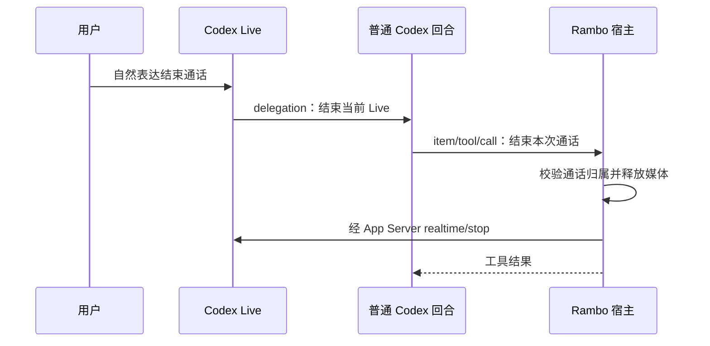

# Codex Voice 独立接入可行性核对

日期：2026-10-20，2026-10-25 补充 0.164.0 协议核对。状态：协议、发行资源和公开源码的静态调查；补充轮次核对了本机 schema，但没有启动新的 Live 音频复验。本文不把静态证据或 Host 集成测试当成麦克风、媒体和真实委派已通过。

对应规则：V01/V02/V07/V09、M07、R11、A01–A03。本文补充[技术设计第 8 节](technical-design.md#8-codex-voice-与唤醒)，不改变产品范围或将待验证功能标记通过。

## 1. 结论

**独立应用接入有明确源码路径，首选客户端 WebRTC + App Server 控制与委派。** Rambo 不必为了语音显示或操纵原生 Codex GUI；客户端负责媒体设备和连接，App Server 处理已有 Codex 认证、通话创建、侧带控制和普通 Codex 回合交接。

但“登录复用后就一定可用”尚未成立：账号/工作区上线资格、服务端对第三方客户端的实际接受情况、媒体连通和模型主动挂断仍须运行验证。当前证据不是完整产品验收。

两项影响实现的重要发现：

- **不要把 WebSocket 音频路径与 WebRTC 认证路径混为一谈。** 本版本直接 WebSocket 音频路径明确要求 API Key 一类凭据；WebRTC 创建路径则明确接入当前 Codex 的 ChatGPT/API 认证。
- **`thread/realtime/stop` 不负责关闭 Rambo 的麦克风和 WebRTC 对象。** 宿主要停止音轨、播放和 PeerConnection；App Server 的空响应或 `closed` 通知不能代替本机媒体释放证据。

## 2. 核对版本与证据等级

### 本机确定版本

- 原调查协议：`/tmp/rambo-design-codex-0163-schema`，来自 `codex-cli 0.163.0`，生成方法见[既有核对](app-server-evidence.md)。
- 2026-10-25 补充核对：`codex-cli 0.164.0` 实验协议生成到 `/tmp/rambo-codex-schema-0164-exp.ngzlL7`；其中 `ThreadRealtimeStartParams` 仍没有 `tools` 或 `dynamicTools`。
- 当前 npm 平台发行资源：`/Users/yuanjiawei/.nvm/versions/node/v24.14.0/lib/node_modules/@openai/codex/node_modules/@openai/codex-darwin-arm64/vendor/aarch64-apple-darwin/`。
- 其中 `codex-resources/voice/manifest.json` 声明 `appVersion: 0.163.0`、`buildCommit: 83086188ae0614bd882818ff1aa23f3194962012`、目标 `aarch64-apple-darwin`。
- 以下公开源码按该 **buildCommit 固定链接**核对；不是把线上 main 的新代码反推成本机能力。源码下载到 `/tmp`，没有改产品源文件。

### 如何解释证据

| 等级 | 本轮能说明什么 | 不能说明什么 |
| --- | --- | --- |
| 本机 schema | 当前二进制暴露这些请求、通知与字段 | 认证成功、服务端开放、真实音频成功 |
| 对应构建源码 | 方法如何转换、认证与媒体控制边界、实际交接代码 | 本机网络、账号、macOS 设备运行结果 |
| 上游测试源码 | 维护者使用模拟服务断言的协议契约 | 本轮已跑过测试或真实服务已通过 |
| 官方产品说明 | 原生产品支持范围和上线条件 | 第三方 App Server 的稳定接入保证 |

公开源码单文件取得成功；完整源码压缩包下载中途超时，仅使用已完整读取的相关成员和单独获取的文件，不把压缩包当完整仓库快照。

## 3. 两层 transport 与媒体协商

### 本地控制连接与上游媒体连接不同

Rambo 与自己启动的 App Server 建议继续使用 stdio JSON-RPC。实时参数中的 `transport` 指 **Voice 上游的连接方式**，不要求把本地控制改成 `--listen ws://...`。官方 App Server 文档说明 stdio 和实验能力初始化；实时方法本身的细节以本机 schema 与源码为准。[官方 App Server](https://learn.chatgpt.com/docs/app-server)

### 本机协议的三个分支

| `thread/realtime/start.transport` | 已核实的结构与处理 | Rambo 用途 |
| --- | --- | --- |
| `{type: "webrtc", sdp: "..."}` | 客户端提交音频及事件通道配置后的 SDP offer；App Server 创建媒体 call 并通过 `thread/realtime/sdp` 通知返回远端 SDP | 首选验证路径 |
| `{type: "websocket"}` | App Server 自己连接 realtime WebSocket；客户端通过 `appendAudio` 输入音频，`outputAudio/delta` 收音频块 | 本版本有独立 API 凭据限制，不作为免额外 Key 的已成立方案 |
| `{type: "existingCall", callId: "..."}` | 加入客户端已经创建并协商完成的 call；拒绝部分 startup/model/voice 配置 | 需要另一个 call 创建方，当前无需引入 |

省略 `transport` 时，core 此入口默认 **WebSocket**；不要因为配置类型中 `realtime.transport` 默认 WebRTC，就认为省略请求参数会自动走 WebRTC。Rambo 应显式传 `webrtc` 和 SDP。[请求适配源码](https://github.com/openai/codex/blob/83086188ae0614bd882818ff1aa23f3194962012/codex-rs/app-server/src/request_processors/turn_processor.rs#L1212)、[core 默认与验证](https://github.com/openai/codex/blob/83086188ae0614bd882818ff1aa23f3194962012/codex-rs/core/src/realtime_conversation.rs#L1350)

### 推荐建立顺序（设计，不是已执行记录）

1. 建立本地控制连接，`initialize` 开启 `capabilities.experimentalApi`，再发 `initialized`。
2. 恢复默认语音 Bot 唯一私聊的 Codex thread；首次使用时创建该唯一 thread，并注册所需宿主动态工具。
3. Rambo 创建 `RTCPeerConnection`，选择输入设备、配置音频及实时事件 data channel，生成 SDP offer。
4. 调 `thread/realtime/start`，显式传 `threadId`、`transport: {type: "webrtc", sdp}`、`outputModality: "audio"`，明确选择待验证的协议版本。
5. 收 `thread/realtime/started`、`thread/realtime/sdp`，将 SDP answer 应用于 PeerConnection；继续等待真实连接与媒体状态。
6. 音频走 WebRTC，App Server 侧带 WebSocket 负责委派、上下文和事件；宿主同时管理 JSON-RPC 通知与本机媒体。

`start` 的空响应只表示提交 core 操作；`started` 也不能替代 ICE、音轨播放和侧带可用状态。创建 call 后，侧带是异步建立的，仍可能发 `error`/`closed`。[core 创建及启动事件](https://github.com/openai/codex/blob/83086188ae0614bd882818ff1aa23f3194962012/codex-rs/core/src/realtime_conversation.rs#L714)、[侧带连接任务](https://github.com/openai/codex/blob/83086188ae0614bd882818ff1aa23f3194962012/codex-rs/core/src/realtime_conversation/sideband.rs#L27)

### 协议版本约束

- 本版本公开 V1/V2/V3；WebRTC 接受 V1 或 V3，拒绝 V2，并要求 conversational 模式。
- V3 对应 Frameless Bidi，源码默认语音模型为 `gpt-live-1-codex`；这只是代码默认值，不能用来承诺账号已开通。
- V1/V3 仅支持 audio output，文本 output 要求 V2；不要组合 WebRTC V3 + text 作为“无麦克风预检”。
- `initialItems` 仅 V3 支持；最多 128 项、合计约 8,192 token。startup context 另有截断预算，不等于把完整 thread 原样塞入语音模型。
- 原生 CLI `/voice` 是交互入口，第三方使用这些 RPC，不向会话发送字面 `/voice` 来建立媒体。

依据：[core 版本与启动上下文](https://github.com/openai/codex/blob/83086188ae0614bd882818ff1aa23f3194962012/codex-rs/core/src/realtime_conversation.rs#L1497)、[上游 WebRTC V3 模拟契约](https://github.com/openai/codex/blob/83086188ae0614bd882818ff1aa23f3194962012/codex-rs/app-server/tests/suite/v2/realtime_conversation.rs#L2620)。这些上游测试本轮没有运行。

## 4. 认证、endpoint 和开关

### WebRTC：可复用 Codex 登录的代码路径成立

`create_realtime_call_with_headers` 调用 `current_client_setup(ConfiguredProvider)`，取得当前 provider 与 `api_auth`，创建 call，并把同一身份的认证头留给侧带连接。源码明确写出：ChatGPT 认证使用 bearer 和 account id，API Key 认证使用相应 bearer。Rambo 客户端取得的是 SDP；call id 和侧带认证保留在 App Server 内，不需要应用读取 `auth.json` 的秘密来自行拼请求。[认证复用实现](https://github.com/openai/codex/blob/83086188ae0614bd882818ff1aa23f3194962012/codex-rs/core/src/client.rs#L512)、[创建调用](https://github.com/openai/codex/blob/83086188ae0614bd882818ff1aa23f3194962012/codex-rs/core/src/client.rs#L740)

已核实的源码路由：

- provider base URL 含 `/backend-api` 时，创建请求使用 JSON 形态，路径为 `realtime/calls`，V1/V3 加 quicksilver/avas 参数；典型 Codex 后端 URL 为 `https://chatgpt.com/backend-api/codex/realtime/calls?...`。
- 公共 API V3 的创建路径为 `live`，其他支持版本为 `realtime/calls`，使用 multipart。
- WebRTC 侧带默认基址是 `https://api.openai.com/v1`，V3 形成 `wss://api.openai.com/v1/live/<callId>`，V1 使用 `realtime?call_id=...`。侧带沿用创建身份，跨这两个域名不是让 Rambo 自行交换令牌。

这些是 **Codex 内部实现事实**，不是建议 Rambo 绕过 App Server 固化调用这些上游 URL。[call 请求形态](https://github.com/openai/codex/blob/83086188ae0614bd882818ff1aa23f3194962012/codex-rs/codex-api/src/endpoint/realtime_call.rs#L65)、[侧带地址构造](https://github.com/openai/codex/blob/83086188ae0614bd882818ff1aa23f3194962012/codex-rs/codex-api/src/endpoint/realtime_websocket/methods.rs#L835)

### WebSocket：不能据此承诺只用 ChatGPT 登录

直接 WebSocket 分支调用 `realtime_api_key`：依次找 provider key、实验 bearer、API Key 认证、OpenAI 环境 Key；没有找到则报 `realtime conversation requires API key auth`。函数注释明确这仍是 ChatGPT/SIWC 会话的临时限制。因此“App Server 两种 transport 都能自动用本机 ChatGPT 登录”在该版本不成立。[API Key 分支](https://github.com/openai/codex/blob/83086188ae0614bd882818ff1aa23f3194962012/codex-rs/core/src/realtime_conversation.rs#L1926)

### 本地开关与服务端资格分开

- JSON-RPC 实时接口和动态工具仍按实验 API 初始化；线上文档说明未 opt-in 会拒绝实验项。[官方初始化说明](https://learn.chatgpt.com/docs/app-server)
- 对应源码中 `features.realtime_conversation` 已为 stable、默认 true，描述针对 TUI。上游 App Server 测试还明确覆盖 legacy flag=false 的 fork/resume 可启动；不要把额外开启旧开关当成账号可用的充分条件。[feature 表](https://github.com/openai/codex/blob/83086188ae0614bd882818ff1aa23f3194962012/codex-rs/features/src/lib.rs#L1991)、[上游旧开关契约](https://github.com/openai/codex/blob/83086188ae0614bd882818ff1aa23f3194962012/codex-rs/app-server/tests/suite/v2/realtime_conversation.rs#L4124)
- 创建调用有可选 attestation header 的代码路径；本轮没证明所有账号是否要求它，也不能假造原生客户端证明。[创建处](https://github.com/openai/codex/blob/83086188ae0614bd882818ff1aa23f3194962012/codex-rs/core/src/client.rs#L749)
- 官方 Voice 页说明原生产品资格仍受计划、上线进度和工作区控制；这不构成 Rambo 已获相同开放条件的证明。[官方 Voice](https://learn.chatgpt.com/docs/features/voice)

## 5. 从语音到普通 Codex 工具，再真正挂断

### 已有明确交接实现

core 收到 `HandoffRequested`，取输入转写与 transcript delta，包装为 `<realtime_delegation>` 并路由到该 session 的普通 Codex 输入；普通 Codex 的输出再通过侧带返回 Live。`clientManagedHandoffs` 默认 false，控制是否自动转发 Codex **输出**，不是“默认完全不执行委派”。[接收与路由](https://github.com/openai/codex/blob/83086188ae0614bd882818ff1aa23f3194962012/codex-rs/core/src/realtime_conversation.rs#L1788)、[交接包装](https://github.com/openai/codex/blob/83086188ae0614bd882818ff1aa23f3194962012/codex-rs/core/src/realtime_conversation.rs#L1903)

上游模拟测试明确断言 WebRTC V1 handoff 创建同 thread 的普通 turn，并将输出送回侧带；另有 WebSocket V2 委派后执行 shell 工具的模拟契约。本轮仅阅读，未运行。[WebRTC handoff 测试源码](https://github.com/openai/codex/blob/83086188ae0614bd882818ff1aa23f3194962012/codex-rs/app-server/tests/suite/v2/realtime_conversation.rs#L2884)、[普通回合工具测试源码](https://github.com/openai/codex/blob/83086188ae0614bd882818ff1aa23f3194962012/codex-rs/app-server/tests/suite/v2/realtime_conversation.rs#L3867)

### 推荐挂断路径（推断，待验证）

- 创建/恢复 thread 时给普通 Codex 暴露窄的宿主动态工具（例如 `end_current_voice_session`）；结束意图由 Codex 判断，Rambo 不匹配固定关键词。
- Live 启动提示必须把当前 Live 的自然、口语、委婉或间接结束表达都识别为结束意图，例如“结束通话”“你可以结束了”“退下吧”；用户不必说“调用工具”。识别后立即委派给 backing Codex，并在委派内容中写出调用 `rambo_voice.end_current_voice_session` 和空对象参数；普通 Codex 得到对应 tool。这条路径复用已有委派机制，避免要求 Live 直接认识所有 App Server `dynamicTools`。Host 的隔离语义兜底提示也覆盖这些表达，但仍按上下文判断、不做关键词触发。
- 0.164.0 本机 `ThreadRealtimeStartParams` 与本版上游 V3 session payload 都没有通用 `tools` 或 `dynamicTools` 注册字段，V3 通过 client delegation 把文本交给普通 Codex；**Live 自身不能直接注册或调用 Rambo 普通线程的 dynamicTools**。在委派里点名工具只是把意图准确交给普通 Codex，不等于结构化工具调用。
- 本机真实会话 `5340e353-5aee-4c65-8365-92e04c741652` 的提醒路径已经证明：Live 只产生 `<realtime_delegation>` 文本，同 thread 的普通 Codex turn 才调用 `rambo_routines.create_routine`；第二次结束请求也由同 thread 的新普通 turn 调用 `rambo_voice.end_current_voice_session`。三次动作的 thread ID 始终是 `01a171c2-fb32-7292-8fa7-df7b0387af66`。
- delegation 与 handoff 是同一条链路的两层：Delegation 是 Live 侧发起委派、携带转写文本；Handoff/HandoffRequested 是 core 接收后包装并转交给普通 Codex 的内部动作。二者都不会为这次执行新建 thread，只会在原 thread 下启动普通 turn。普通 Codex 的回复再经侧带回到 Live。
- Host 用自身绑定的 `voiceSessionId + threadId` 处理本次调用；旧 call 的延迟结果不能结束新 call。当前 stop RPC 只有 threadId，没有 expected session id，因此宿主必须串行化该 thread 的结束与重连，发送过期 stop 前先核本地状态。
- 工具先取得挂断请求的可识别结果，媒体与服务端停止通过独立状态收尾，避免等待当前模型回合完成才挂断而形成相互等待；具体时序仍需验证。
- M07 的语音记忆批准和 R11 的计划管理可走同一 delegation→普通 Codex 宿主工具通路，仍需分别验收，不能用“能挂断”代替全部语音工具成功。
- 宿主仍须保留语义兜底：用户 Realtime 转写完成和收到 `handoff_request` 时分别触发一次隔离、只读、无工具的意图判定；同一转写 item 去重，只有明确高置信度结束时才停止 Live。这样即使 Live 只口头告别而没有 delegation，也有一次独立处理机会；该兜底已由 Host 集成覆盖，仍需真实 Live 音频验证。

动态工具的 `item/tool/call` 参数包括 threadId、turnId、callId、工具名和 arguments，结果为 success/contentItems；这是普通 turn 的接口，不是 WebRTC data channel 中天然同名的工具。[官方动态工具说明](https://learn.chatgpt.com/docs/app-server)

## 6. `start` / `stop` 的真实边界

| 动作 | 源码已核实 | 宿主仍须负责 / 未知 |
| --- | --- | --- |
| start 同 thread 的新实时会话 | 停掉该 thread 旧 realtime state，发送旧 closed，然后建立新状态 | 旧通知与新通话对应、客户端旧 PeerConnection 清理 |
| stop RPC | 提交 `RealtimeConversationClose`，返回空结果 | 不表示音轨和远端媒体已停止 |
| core close | 清 realtime state、取消输入任务、等待 fanout 收尾、发 closed(reason=requested) | 没有在此路径看到调用远端 call hangup API；不能承诺 sideband 关了媒体必关 |
| closed 通知 | 标识 core realtime transport 关闭，可能 requested/transport_closed/error | Rambo 要实际停止采集、输出、关闭 PeerConnection/data channel，按开关回唤醒 |
| transcript tail | 可选择在结束前落剩余转写，默认 flush 开关 false | 启用后的漏尾/重复、故障时行为需验证 |
| 普通任务 | realtime close 与 turn/interrupt 是不同操作 | 已开始独立任务继续、结束时不产生误重复委派需验收 |

依据：[App Server stop 映射](https://github.com/openai/codex/blob/83086188ae0614bd882818ff1aa23f3194962012/codex-rs/app-server/src/request_processors/turn_processor.rs#L1389)、[停止 realtime state](https://github.com/openai/codex/blob/83086188ae0614bd882818ff1aa23f3194962012/codex-rs/core/src/realtime_conversation.rs#L1270)、[close 处理](https://github.com/openai/codex/blob/83086188ae0614bd882818ff1aa23f3194962012/codex-rs/core/src/realtime_conversation.rs#L2037)、[关闭通知](https://github.com/openai/codex/blob/83086188ae0614bd882818ff1aa23f3194962012/codex-rs/core/src/realtime_conversation.rs#L2812)。

本机 `closed` 通知只有 threadId/reason，没有独立 call token，`started` 才带可空 realtimeSessionId。不能假设通知天然解决所有新旧通话竞争。

## 7. 随包 voice host 是什么

当前 0.163.0 平台包确有 `codex-resources/voice/bin/codex-voice-host`，并含 GStreamer/GLib/Opus 动态库、插件、manifest、NOTICE 和许可文件。此目录实际文件大小合计 **21,163,707 bytes（约 20.18 MiB）**；主机程序单文件约 9.1 MiB 不是完整语音运行资源体积。

`runtime.json` 标明 `developmentOnly: false`，依赖通过相邻目录的 `@loader_path` 引用。`NOTICE.md` 说明这些库有各自许可、源版本在 sources.json、替换库在 macOS 需有效签名。此处仅记录已有发行资源，不给出未完成的重分发或签名结论。[对应构建资源说明](https://github.com/openai/codex/blob/83086188ae0614bd882818ff1aa23f3194962012/third_party/voice/README.md)

**不能由“包里有 voice host”推出 App Server 每条实时通路都会启动它。** 已追到的 App Server WebRTC 通路接受客户端 SDP，将媒体端点留给客户端，没有在该调用链发现启动本地 voice host。若 Rambo 使用 Chromium WebRTC，媒体可由自身客户端实现，这是源码边界支持的设计推断；voice host 能否作为现成设备适配器复用，其 IPC、签名、设备语义未在本轮证实。不应在此阶段承诺直接复用即可满足 V14。

## 8. 最小后续验证清单（本轮未执行）

按顺序安排，保留脱敏事件轨迹；不记录 token、完整音频或整包含敏感转写的调试消息。

1. **独立初始化与登录资格**：应用持有的 stdio 子进程，复用已有本机 Codex 认证；不依赖原生 GUI；检查未登录、过期、无资格时的真实错误。
2. **WebRTC 媒体闭环**：显式 V3/audio/webrtc offer，收 started+SDP，确认 ICE、麦克风输入、模型输出播放、侧带与转写均可用。V1 仅作协议兼容对照，不能静默替换最终体验。
3. **线程一致性**：已有文字上下文在 Live 可用；Live 委派在预期 thread 上产生 turn；普通文字、语音回复及转写不重复落聊天。
4. **工具闭环**：先无外部副作用的宿主动态工具，再分别验证结束通话、语音记忆确认、计划管理；保留 request/call/turn/session 关联证据。
5. **真正挂断**：用户自然结束意图→委派→宿主工具→本机采集停止/播放停止/PeerConnection关闭→stop与closed→已开唤醒才恢复；不靠口头“再见”、静音或字符串匹配蒙混。
6. **结束时有任务**：结束 Live 后独立工作继续；转写尾部不被重复当成新任务；旧 call 延迟挂断不影响刚开始的新 call。
7. **故障释放**：侧带断线、SDP失败、权限撤回、固定耳机断开、App Server退出均释放本机媒体并显示真实状态，不无限占用麦克风。
8. **用户环境**：外接显示器+耳机麦克风合盖模式、V10空闲自动结束、唤醒/Live设备交接按原验收矩阵实测；此调查不代替硬件验证。

任一环节未成立，保持对应功能“阻塞/未通过”，继续解决底层接入，不能缩掉已确认的 Voice、挂断或免额外服务 Key 目标来报告完整交付。
